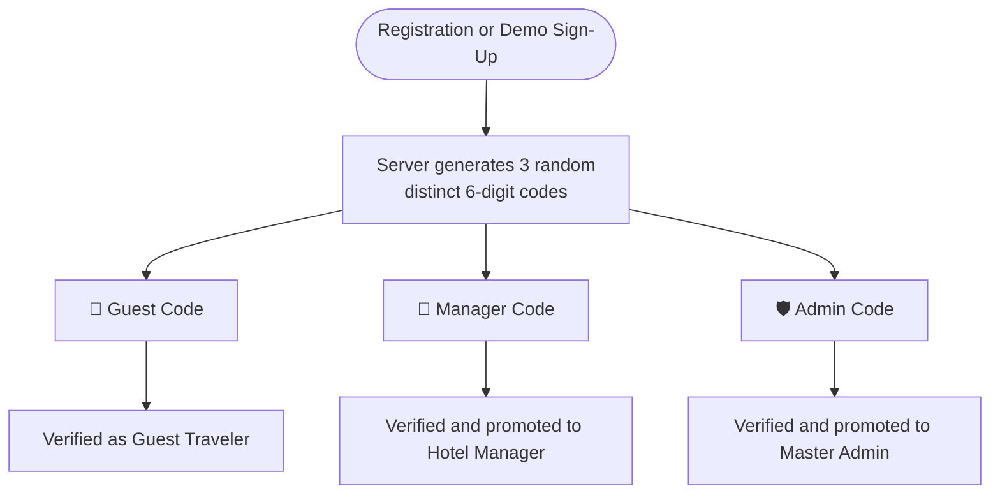
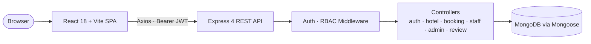

<div align="center">


# ✦ StayWise ✦

**Bespoke Luxury Hotel Discovery & Reservation Engine**

<a href="#-feature-suite">
  
</a>

<br />


<br />


<br /><br />

**[Overview](#-project-overview)** &nbsp;◆&nbsp;
**[Features](#-feature-suite)** &nbsp;◆&nbsp;
**[RBAC](#-3-tier-role-based-access-control)** &nbsp;◆&nbsp;
**[Manager Portal](#-hotel-manager-portal--staff-roster)** &nbsp;◆&nbsp;
**[3-Code Verification](#-dynamic-3-code-verification)** &nbsp;◆&nbsp;
**[Logic](#-business-logic--formulas)** &nbsp;◆&nbsp;
**[Architecture](#-architecture)** &nbsp;◆&nbsp;
**[API](#-rest-api-reference)** &nbsp;◆&nbsp;
**[Quick Start](#-quick-start)** &nbsp;◆&nbsp;
**[Tests](#-automated-test-suite)**

</div>

---

## ✦ Project Overview

**StayWise** is a full-stack hotel booking and comparison platform built for **CS3301 Full Stack Development (CIE-3)**. It tackles the hidden fees, fragmented search and rigid flows of typical travel portals.

<div align="center">

| 🏛️ Catalog | ⚖️ Compare | 💰 Pricing | 🛏️ Capacity | 👥 Roles | 🔐 Verification |
|:---:|:---:|:---:|:---:|:---:|:---:|
| **84 Hotels** | **3-Property Matrix** | **Exact to the Rupee** | **2 Adults + 1 Child / Room** | **3 Tiers** | **3 Dynamic Codes** |
| 7 Indian Destinations | Best Value Seal | Subtotal + ₹500 Fee | 1-Click Auto-Upgrade | Guest · Manager · Admin | New Every Time |

</div>

**Design language:** warm alabaster `#fbf8f2` · obsidian ink `#0b0b0e` · champagne gold `#c5a059`, set in *Playfair Display*.

---

## ✦ Feature Suite

### 🔍 Discovery & Catalog
- **84 curated properties** across **Goa, Jaipur, Udaipur, Kerala, Manali, Mumbai and Varanasi**
- **Price slider** ₹1,000 – ₹12,000 per night with live hotel counts
- **Star tiers:** Any · 3.5★+ · 4.0★+ · 4.5★+ · 4.8★+
- **Amenity filters:** Wi-Fi, Pool, Spa, Ocean/Mountain View, Fine Dining, Fitness Center, Airport Transfers
- **Editorial badges:** *Best Value*, *Top Rated (4.8+)*, *Heritage Palace*, *Trending Sanctuary*

### ⚖️ Side-by-Side Comparison
- Pin up to **3 hotels** in a persistent bottom drawer
- Compare price, rating, room types, location and amenities
- **Best Value** gold seal from a transparent scoring formula

### 💰 Duration Stepper & Rupee Budgeting
- Quick duration steps: **3 · 7 · 10 · 14 nights**
- Sticky live estimator: `Nightly Rate × Nights × Rooms` + flat **₹500** service fee
- Client estimate and server validation use the **same formula**

### 🛏️ Room Capacity Guard
- **Max 2 adults and 1 child per room**
- Live warning with a one-click **`➕ Book N Rooms`** auto-upgrade
- Server rejects over-capacity requests with `400 Bad Request`

### 🎟️ Digital Booking Pass
- Collision-free references: `SW-BK-XXXXX`
- Printable pass with QR placeholder, hotel contact and guest breakdown
- Public **`/verify-booking`** portal to check authenticity and status

### 📂 Reservation Management
- **My Bookings** drawer with live history
- **Modify** dates, duration or rooms with automatic re-pricing
- **Cancel** with a mandatory reason; inventory is released and status becomes `cancelled`

### 🔔 Notifications & ⭐ Verified Reviews
- Notification bell with unread badge, 30 s polling and mark-all-read; created on booking and cancellation
- Reviews with rating and comment, **restricted to guests with a confirmed reservation**
- Recently viewed hotels are recorded to the user profile

### 🛡️ Resilience
- Self-healing React `ErrorBoundary` with an editorial fallback and instant recovery actions

---

## ✦ 3-Tier Role-Based Access Control

```text
┌──────────────────────────────────────────────────────────────────────────────────────┐
│                     STAYWISE ROLE-BASED ACCESS CONTROL (RBAC)                        │
├──────────────────────────┬─────────────────────────────┬─────────────────────────────┤
│     👤 GUEST TRAVELER    │      🏨 HOTEL MANAGER       │       🛡️ MASTER ADMIN       │
├──────────────────────────┼─────────────────────────────┼─────────────────────────────┤
│ • Explore 84 stays       │ • Manager Portal (/manager) │ • Executive Console (/admin)│
│ • Side-by-side compare   │ • Staff Roster, full CRUD   │ • MongoDB aggregation KPIs  │
│ • Live reservations      │ • Shift scheduling          │ • Hotel catalog management  │
│ • Modify / cancel stays  │ • Managed property stays    │ • User role governance      │
│ • Printable digital pass │ • Property bookings stream  │ • Deep link to Staff Roster │
│ • Verified reviews       │                             │                             │
└──────────────────────────┴─────────────────────────────┴─────────────────────────────┘
```

Enforced on the client with `<ProtectedRoute>` and on the server with the `protect` and `authorizeRoles` middleware.

---

## ✦ Hotel Manager Portal & Staff Roster

The **`/manager`** portal is built for hotel operators.

| Capability | Details |
|:---|:---|
| **Live personnel table** | Staff ID, name, department, role, shift, property, monthly salary (₹), emergency contact |
| **Departments** | 🛎️ Front Desk & Concierge · 🧹 Housekeeping & Facilities · 🍳 Culinary & Fine Dining · 🛡️ Security & Safety · 💼 Hotel Operations & Management |
| **Shift rostering** | Morning `06:00–14:00` · Evening `14:00–22:00` · Night `22:00–06:00` |
| **1-click status toggle** | **Active** `#10b981` ⇄ **On Leave** `#f59e0b`, persisted instantly |
| **Search & filter** | Department tabs plus name / ID search |
| **Add staff modal** | Validated form with instant roster refresh |
| **Pre-seeded roster** | 8 staff members across top resorts |
| **Managed inventory** | Live pricing, room stock and ratings for the manager's properties |
| **Reservations stream** | Incoming bookings with guest names, check-in dates and totals |

---

## ✦ Dynamic 3-Code Verification

Built for **zero-friction evaluation**: every registration (or resend) issues three fresh, distinct 6-digit codes.



- 🎲 **Randomized every time**: each registration or *Resend Code* returns three new codes
- 🖱️ **1-click role cards**: clicking a card auto-fills the input
- ⬆️ **Direct role elevation** to `guest`, `hotel_manager` or `admin` by the code submitted
- ⌨️ **Unified input**: one 6-digit field (`letterSpacing: 0.35em`), no fragile OTP boxes
- ⏳ **30-second cooldown** on resend
- 🧹 **Codes cleared** after successful verification

---

## ✦ Business Logic & Formulas

**1 · Best Value Score**

$$\text{Best Value} = \left(\frac{\text{Rating}}{\text{Nightly Price}} \times 10{,}000\right) + \text{Amenities Count}$$

**2 · Deterministic Pricing**

$$\text{Grand Total} = (\text{Nightly Rate} \times \text{Nights} \times \text{Rooms}) + ₹500$$

**3 · Room Occupancy**

$$\text{Required Rooms} = \max\left(1,\ \left\lceil \frac{\text{Adults}}{2} \right\rceil,\ \text{Children},\ \left\lceil \frac{\text{Adults} + \text{Children}}{3} \right\rceil\right)$$

---

## ✦ Architecture



| Layer | Stack |
|:---|:---|
| **Frontend** | React 18.3, Vite 5.4, React Router, `ErrorBoundary`, `ProtectedRoute` |
| **Backend** | Node.js 18+, Express 4.21, JWT, bcryptjs |
| **Database** | MongoDB (local or Atlas) with Mongoose schemas |
| **Testing** | End-to-end integration suite (`backend/scripts/testSuite.js`) and Postman collection |
| **Deploy configs** | `frontend/vercel.json` and Render-ready `backend/server.js` |

---

## ✦ REST API Reference

| Module | Method | Endpoint | Access | Description |
|:---|:---:|:---|:---|:---|
| **Auth** | `POST` | `/api/auth/register` | Public | Register and generate 3 distinct codes |
| **Auth** | `POST` | `/api/auth/verify-code` | Public | Verify code and promote to Guest, Manager or Admin |
| **Auth** | `POST` | `/api/auth/resend-code` | Public | Regenerate 3 new distinct codes |
| **Auth** | `POST` | `/api/auth/login` | Public | Authenticate and issue Bearer JWT |
| **Auth** | `GET` | `/api/auth/me` | Authenticated | Current user profile |
| **Hotels** | `GET` | `/api/hotels` | Public | List hotels with multi-variable filters |
| **Hotels** | `GET` | `/api/hotels/:id` | Public | Single hotel and room details |
| **Hotels** | `POST` | `/api/hotels` | Admin | Create a hotel |
| **Hotels** | `PUT` | `/api/hotels/:id` | Admin | Update a hotel |
| **Hotels** | `DELETE` | `/api/hotels/:id` | Admin | Soft-delete a hotel |
| **Bookings** | `POST` | `/api/bookings` | Authenticated | Create reservation with capacity check |
| **Bookings** | `GET` | `/api/bookings/my` | Authenticated | Reservation history |
| **Bookings** | `GET` | `/api/bookings/verify/:ref` | Public | Verify a booking reference |
| **Bookings** | `PUT` | `/api/bookings/:id/modify` | Authenticated | Modify dates / rooms |
| **Bookings** | `PATCH` | `/api/bookings/:id/cancel` | Authenticated | Cancel with mandatory reason |
| **Staff** | `GET` | `/api/staff` | Manager, Admin | Staff roster |
| **Staff** | `POST` | `/api/staff` | Manager, Admin | Add staff member |
| **Staff** | `PUT` | `/api/staff/:id` | Manager, Admin | Update details, shift or salary |
| **Staff** | `PATCH` | `/api/staff/:id/status` | Manager, Admin | Toggle Active / On Leave |
| **Staff** | `DELETE` | `/api/staff/:id` | Manager, Admin | Remove staff member |
| **Admin** | `GET` | `/api/admin/dashboard` | Admin | MongoDB aggregation KPIs |
| **Admin** | `GET` | `/api/admin/users` | Admin | User governance directory |
| **Admin** | `PATCH` | `/api/admin/users/:id/role` | Admin | Promote or demote a user |

---

## ✦ Quick Start

**Prerequisites:** Node.js ≥ 18 and MongoDB (local `mongodb://127.0.0.1:27017` or an Atlas URI).

### 1 · Clone

```bash
git clone https://github.com/Dhruvi-tech/Staywise-Hotel-Booking.git
cd Staywise-Hotel-Booking
```

### 2 · Backend

```bash
cd backend
npm install
cp .env.example .env
```

`backend/.env`
```env
PORT=5000
MONGO_URI=mongodb://127.0.0.1:27017/staywise_db
JWT_SECRET=<your-long-random-secret>
CLIENT_URL=http://localhost:3000
```

```bash
npm run seed:hotels    # 84 curated hotels (idempotent)
npm run seed:admin     # admin, manager, guest accounts + staff roster
npm start              # http://localhost:5000  ·  health: /api/health
```

### 3 · Frontend (new terminal)

```bash
cd frontend
npm install
cp .env.example .env
```

`frontend/.env`
```env
VITE_API_BASE_URL=http://localhost:5000/api
```

```bash
npm run dev            # http://localhost:3000
```

### 🔑 1-Click Evaluator Sign-In

Use the **1-Click Demo** buttons on `/login`, or sign in manually:

| Role | Email | Password | Portal | What to evaluate |
|:---|:---|:---|:---:|:---|
| 🛡️ **Administrator** | `admin@staywise.com` | `Admin@123456` | `/admin` | Aggregations, hotel CRUD, user governance |
| 🏨 **Hotel Manager** | `manager@staywise.com` | `Manager@123456` | `/manager` | Staff roster CRUD, shift toggles, managed stays |
| 👤 **Guest Traveler** | `guest@staywise.com` | `Guest@123456` | `/` | 84 stays, compare, live booking, passes |

> 💡 Or open `/register` and click **⚡ Demo Sign Up** to see the 3-code system live.
>
> ⚠️ These are demo credentials for evaluation only. Use a strong, private `JWT_SECRET` and change all passwords in any real deployment.

---

## ✦ Automated Test Suite

```bash
cd backend
npm test
```

<details>
<summary><b>▶ Expand full execution summary (24 / 24 passing)</b></summary>

```text
==================================================
 STAYWISE CIE-3 COMPREHENSIVE TEST SUITE EXECUTION
 Target API: http://localhost:5000/api
==================================================

--- 1. Authentication & Role-Based Authorization ---
  ✓ PASS: TC01: Register New Guest Account
  ✓ PASS: TC02: Register New Hotel Manager Account
  ✓ PASS: TC03: Reject Duplicate Email Registration with 400
  ✓ PASS: TC04: Admin Login & Token Acquisition
  ✓ PASS: TC05: Guest Login & Token Acquisition
  ✓ PASS: TC06: Reject Invalid Login Credentials with 401
  ✓ PASS: TC07: Verify Authenticated Profile via /api/auth/me
  ✓ PASS: TC08: Stateless Logout Acknowledgement

--- 2. User Profile & Preferences ---
  ✓ PASS: TC09: Retrieve User Profile with Reservation Metrics
  ✓ PASS: TC10: Update User Profile Details
  ✓ PASS: TC11: Change User Password

--- 3. Hotel REST APIs ---
  ✓ PASS: TC12: Retrieve All Hotels (Total 84 Preserved)
  ✓ PASS: TC13: Search Hotels by Destination (Goa)
  ✓ PASS: TC14: Filter Hotels by Min Rating (4.8) & Max Price (10000)
  ✓ PASS: TC15: Retrieve Hotel by Legacy Custom ID ("hotel-1")
  ✓ PASS: TC16: Create New Hotel Property (Admin RBAC)

--- 4. Booking REST APIs ---
  ✓ PASS: TC17: Create Valid Reservation (Subtotal + ₹500 fee on DB price)
  ✓ PASS: TC18: Reject Over-Capacity Reservation with 400 (4 adults in 1 room)
  ✓ PASS: TC19: Fetch User Bookings (GET /api/bookings/my)
  ✓ PASS: TC20: Modify Reservation Dates & Rooms
  ✓ PASS: TC21: Public Digital Verification of Booking Reference
  ✓ PASS: TC22: Cancel Reservation with Reason

--- 5. Admin Dashboard & Notifications ---
  ✓ PASS: TC23: Executive Dashboard MongoDB Aggregations
  ✓ PASS: TC24: Retrieve User In-App Notifications

==================================================
 TOTAL: 24   PASSED: 24   FAILED: 0   SUCCESS RATE: 100%
==================================================
```

</details>

📮 **Postman:** import `staywise_postman_collection.json` to run all 24 cases with preconfigured variables, token extraction and assertions.

---

## ✦ Demo Walkthrough (5 Flows)

1. **Catalog & capacity guard:** `/hotels` → 4 adults, 1 room → see the warning → click `➕ Book 2 Rooms`
2. **3-hotel comparison:** `/compare` → explain the Best Value formula
3. **3-code verification:** `/register` → `⚡ Demo Sign Up` → click `🏨 Manager` → verify into the Manager Portal
4. **Staff roster:** `/manager` → filter by department → toggle Active ⇄ On Leave
5. **Test suite:** run `npm test` in `backend/` → 24/24 green

<br />

<div align="center">

### ✦ Find. Compare. Book. Stay. ✦


<sub><b>StayWise</b> · CS3301 Full Stack Development (CIE-3)<br />Bespoke Editorial Luxury Hotel Discovery & Reservation Engine</sub>

</div>
